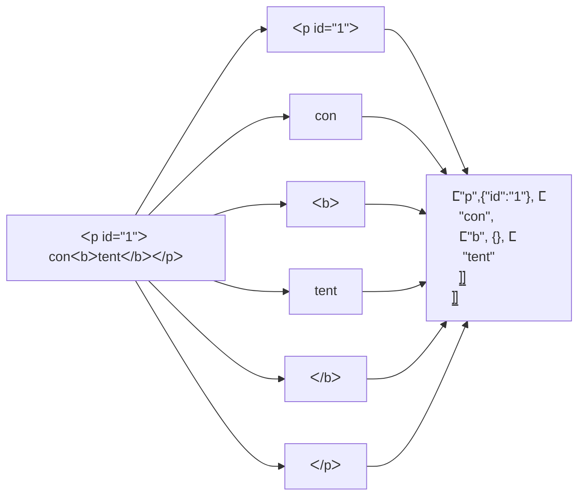

# html.jq

Process HTML from jq - no dependency

## REQUIREMENT

- jq1.7+ (use of `scan/2`)

## PREVIEW

<table>
<tr><td>

```html
<!DOCTYPE html>
<html lang="en">
  <head>
    <meta charset="utf-8" />
    <title>Basic Example</title>
    <link rel="stylesheet" />
    <!--some comment-->
  </head>
  <body id="home">
    <input type="text">
    <hr>
    <p>content</p>
  </body>
</html>
```

</td><td>

```jsonc
// <!doctype> is ommited
["html",{"lang":"en"},[
    ["head", {}, [
        ["meta", {"charset": "utf-8"} ],
        ["title", {}, ["Basic Example"] ],
        ["link", {"rel": "stylesheet"} ]
        //comment is ommited
    ]],
    ["body", {"id": "home"}, [
        ["input", {"type": "text"}],
        ["hr"],
        ["p", {}, ["content"]]
    ]]
]]
```

</td></tr>
</table>

## USAGE

```sh
# direct call supported
./html.jq < tests/base.html
# full jq slug+Raw+file invocation
jq -sRf ./html.jq < tests/base.html
# piping from curl
curl example.com | ./html.jq

# select all "a" element's .href, i.e. $$("a").map(a=>a.href)
cat my.html | ./html.jq | jq '..|arrays|select(.[0]=="a")[1].href'
# select element by .id attribute, i.e. $$("[id=footer]")
cat my.html | ./html.jq | jq '..|arrays|select(try(.[1].id == "footer") catch false)'
```

## WORKFLOW

The parsing is done in two steps:
first, it tokenize the raw input string.
then, it parse each token into a stack of JSONML items



## TESTS

Run non-regression [./tests/](./tests/) with

```sh
./tests.sh
```
